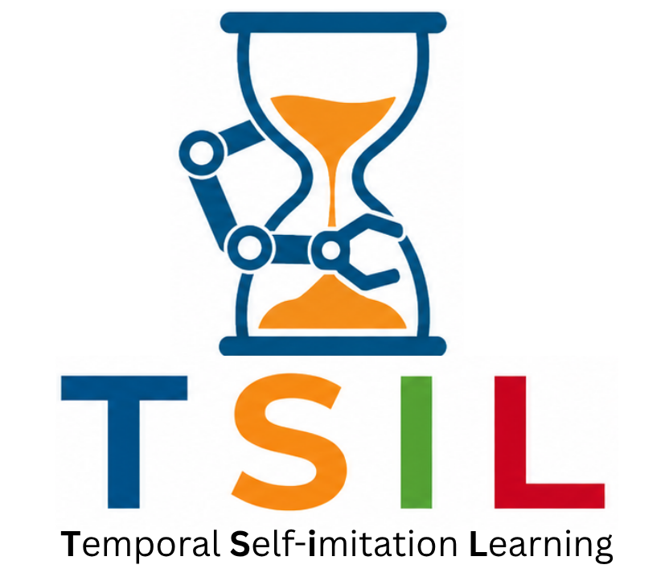
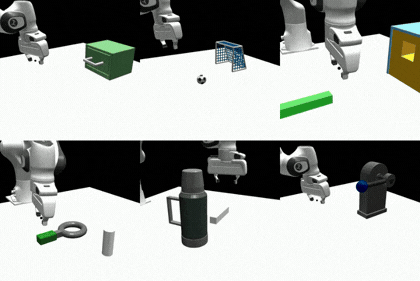
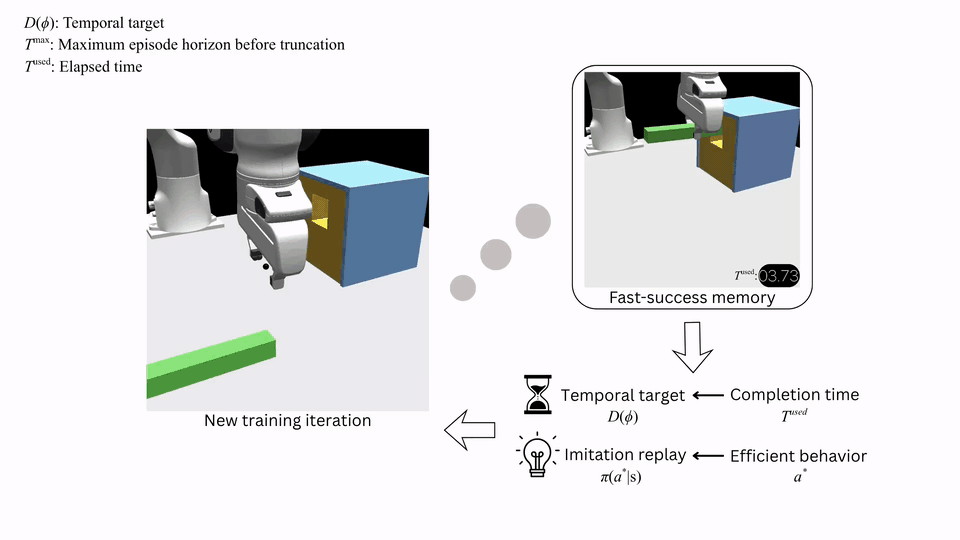

<p align="center">
  
</p>

<p align="center">
  <a href="https://colab.research.google.com/github/generalroboticslab/TSIL/blob/main/notebooks/TSIL_demo.ipynb"></a>
  <a href="LICENSE"></a>
  <a href="https://www.youtube.com/watch?v=Nng0trpbqW8"></a>
  <a href="https://arxiv.org/abs/2606.19752"></a>
  <a href="https://generalroboticslab.com/TSIL"></a>
</p>

## Temporal Self-Imitation Learning (TSIL)

<div>
  

  <p>
    Temporal Self-Imitation Learning (TSIL) is a reinforcement learning framework that uses self-generated fast-success trajectories as self-supervision for long-horizon robot manipulation. By deriving adaptive temporal targets and replaying efficient behaviors, TSIL helps policies mitigate reward hacking, exploit rare fast-success experience, and improve both task completion and efficiency.
  </p>

  <p>
    This repository includes TSIL training and evaluation for MetaWorld and MiniGrid environments.
  </p>
</div>

## 5-minute Mini Demo

The fastest way to understand TSIL is through the mini demo:

- Open in Colab:
  [notebooks/TSIL_demo.ipynb](https://colab.research.google.com/github/generalroboticslab/TSIL/blob/main/notebooks/TSIL_demo.ipynb)
- Read in GitHub:
  [notebooks/TSIL_demo.ipynb](notebooks/TSIL_demo.ipynb)

The demo uses a tiny maze to show how fast rollout successes can become self-supervisory signals. It then illustrates how these signals, adaptive temporal targets and fast-success replay, change learning behavior before scaling to long-horizon manipulation tasks.

Saved outputs let you read through the notebook on GitHub without running it.

## Method Intuition

TSIL is based on a simple idea: a fast successful trajectory from previous interactions shows not only which actions worked, but also how quickly a task can be solved. TSIL turns these fast successes into two complementary learning signals for future policy improvement:

- **Adaptive temporal targets:** fast successes update the target completion time for tasks iteratively, encouraging increasingly efficient solutions.
- **Fast-success self-imitation:** efficient successful trajectories are replayed with efficiency-weighted supervision, helping the policy revisit those "shining" motions that may otherwise be forgotten.

Together, these signals, which are naturally generated by the policy itself, help reduce reward over-exploitation, preserve efficient behaviors discovered during training, and improve task-completion efficiency. A detailed demo is shown below:

<p align="center">
  
</p>

## Training and Evaluation

### Quick Start

Clone the repository and enter its folder:

```bash
git clone https://github.com/generalroboticslab/TSIL.git
cd TSIL
```

Run all commands below from this `TSIL/` repository folder.

For MetaWorld (Linux, NVIDIA GPU), Isaac Gym Preview 4 is included in
`isaacgym/` at the repository root. Install it and the MTBench environments:

```bash
conda env create -f tsil.yml
conda activate tsil
pip install -e ./isaacgym/python
pip install -e ./MTBench
pip install -r requirements.txt
```

For MiniGrid alone, Isaac Gym is not required. To install on CPU:

```bash
python3.8 -m venv .venv
source .venv/bin/activate
python -m pip install --upgrade pip
python -m pip install torch==2.4.1 --index-url https://download.pytorch.org/whl/cpu
python -m pip install -r requirements.txt
```

Use `--device cpu` for CPU training and evaluation. For GPU MiniGrid, install
the CUDA build of PyTorch instead.

`--dry-run` prints the resolved command and settings without starting training
or evaluation:

```bash
python -m projects.TSIL.run train --benchmark metaworld --task 1 --seed 48 --dry-run
python -m projects.TSIL.run train --benchmark minigrid --task 10 --seed 42 --dry-run
```

### Training

Train TSIL on a MetaWorld or MiniGrid task using adaptive temporal targets and
replay of fast successful trajectories.

```bash
python -m projects.TSIL.run train --benchmark metaworld --task 1 --seed 48 --gpu 0
python -m projects.TSIL.run train --benchmark minigrid --task 10 --seed 42 --gpu 0
```

Add `--smoke` for a short training run, or `--iterations N` to set the update
budget. The commands above use the default TSIL settings.

Add `--output results/my_experiment` to choose a parent directory. Every run uses
a unique timestamp; prior results are not overwritten. Use a detached terminal
such as tmux for full training.

MetaWorld task IDs are 0, 1, 2, 3, 14, 18, 21, 22, 27, 28, 29, 30, 43, 44, 46.
MiniGrid task IDs are 0–14. Task settings are in [configs/](configs/).

### Evaluation

`RUN_DIR` is the directory containing `config.json`, `plot_metrics_history.jsonl`
and `checkpoints/`, printed near the start of training. Keep the complete run
directory, including `.minigrid.json` / `.metaworld.json` checkpoint sidecars.

```bash
python -m projects.TSIL.run eval --run-dir RUN_DIR --episodes 2000 --gpu 0 --dry-run
python -m projects.TSIL.run eval --run-dir RUN_DIR --episodes 2000 --gpu 0
```

The default checkpoint is `best_suc_tail`. For short smoke runs, use
`--checkpoint last`. For CPU MiniGrid evaluation, add `--device cpu`.

### Command Options

Use `python -m projects.TSIL.run train --help` or
`python -m projects.TSIL.run eval --help` to see the available options.

| Option | Meaning |
| --- | --- |
| `--benchmark` | Training benchmark: `metaworld` or `minigrid`. |
| `--task` | Task ID from the lists above; trains one task. |
| `--seed` | Policy/training random seed; defaults to 48 for MetaWorld and 42 for MiniGrid. |
| `--gpu` | GPU index to use; defaults to 0. Ignored when using CPU. |
| `--device` | `cuda` (default) or `cpu`; CPU is supported for MiniGrid only. |
| `--dry-run` | Print the command/settings without running it. Evaluation still requires an existing run and checkpoint. |
| `--smoke` | Short training check: 12 updates, with 640 environments for MetaWorld. |
| `--iterations` | Number of training updates; overrides the default budget or `--smoke` budget. |
| `--output` | Parent folder for new training runs; defaults to `results/`. |
| `--run-dir` | Saved training folder to evaluate. |
| `--episodes` | Total evaluation episodes; defaults to 2,000 and must be at least 32. |
| `--checkpoint` | Model to evaluate: `best_suc_tail` (default) or `last`. |

### Results Layout

Each training command creates a new run under `results/`. `RUN_DIR` refers to
its innermost folder, containing `config.json` and `checkpoints/`.

```text
results/
├── <benchmark>_T<task>_s<seed>_<timestamp>/
│   ├── launch.json                      # Command and training arguments
│   └── <benchmark>/<experiment>/<stage>/T<task>/<method>/<timestamp>/<run_name>/
│       ├── config.json                  # Saved run settings (this folder is RUN_DIR)
│       ├── data.csv                     # Training summary
│       ├── plot_metrics_history.jsonl   # Training curves and scalar metrics
│       ├── checkpoints/
│       │   ├── eps_last                 # Final model
│       │   ├── eps_best_suc_tail        # Selected model from late training
│       │   └── *.minigrid.json / *.metaworld.json  # Checkpoint settings
│       ├── trajectories/                # Saved trajectories and diagnostic histories
│       │   ├── training_signal_history.jsonl
│       │   └── training_episode_signal_history.jsonl
│       ├── minigrid_evaluation_best_suc_tail.json  # MiniGrid evaluation
│       ├── minigrid_evaluation.json      # MiniGrid evaluation of eps_last
│       └── evaluation/                  # MetaWorld evaluation
│           └── <task>/<evaluation_run>/
│               ├── config.json
│               └── data.csv
└── TSIL/paper_artifacts/<report_name>/
    ├── sources.json                     # Runs and evaluations used for the report
    ├── figures/                         # Summary and per-task PDFs
    └── tables/
        ├── summary_csv/                 # Aggregate training metrics
        ├── summary_md/                  # Readable Markdown tables
        ├── raw/                         # Per-run training metrics
        └── evaluation_runs.csv          # Available checkpoint evaluations
```

Files depend on the benchmark and which commands have completed. Keep each
checkpoint with its accompanying metadata files. Use `--output` in the training
command to choose a different results location.

### Plot/Table

Generate figures and tables from a completed run:

```bash
python -m projects.TSIL.plot runs --run-dirs RUN_DIR --labels TSIL --output results/TSIL/paper_artifacts/my_report
```

Here, `--run-dirs` lists saved training folders, `--labels` names their methods,
and `--output` selects a new report folder. Run
`python -m projects.TSIL.plot runs --help` for all reporting options.

The report includes training curves, success/AUC summaries, completion times,
success counts, and per-task plots. Evaluation figures require saved evaluations
for all selected runs. Figures are PDFs; tables are CSV and Markdown.

To compare methods or combine seeds, pass multiple run folders. Reuse a label
for seeds of the same method:

```bash
python -m projects.TSIL.plot runs --run-dirs RUN_A RUN_B --labels TSIL TSIL --output results/TSIL/paper_artifacts/two_seeds
```

Generate separate reports for MetaWorld and MiniGrid. Use a new output folder
for each report. See [plotting and table commands](docs/plotting.md) for
learning-signal diagnostics, replay analysis, disturbance results, and sweeps.

## Repository Layout

```text
TSIL/
├── configs/
│   ├── metaworld/                       # Task-specific training settings
│   └── minigrid/
├── core/
│   ├── agents/                          # Actor, critic and observation processing
│   ├── training/
│   │   ├── trainer.py                   # Training lifecycle
│   │   ├── rollout.py                   # Environment interaction and reward handling
│   │   ├── storage.py                   # Rollout data
│   │   ├── args.py                      # Shared options
│   │   ├── metrics.py                   # Training metrics and model selection
│   │   ├── logger.py                    # Saved histories
│   │   └── algo/
│   │       ├── ppo.py                   # PPO objective
│   │       ├── updater.py               # Joint optimization
│   │       └── tsil/
│   │           ├── memory.py            # Trajectory storage and selection
│   │           ├── sampling.py          # Replay batch preparation
│   │           ├── positive_sampling.py # Prioritized transition sampling
│   │           ├── loss.py              # TSIL replay objective
│   │           └── replay_normalization.py # Replay weight scaling
│   ├── evaluation/                      # Evaluation and trajectory utilities
│   ├── plotting/                        # Shared styles, data loading and drawing
│   └── common/                          # Checkpoint and path helpers
├── projects/TSIL/
│   ├── run.py                           # Training/evaluation command-line interface
│   ├── train.py                         # Training entrypoint
│   ├── training.py                      # TSIL options and trainer
│   ├── agents.py                        # TSIL policy setup
│   ├── eval.py                          # MetaWorld evaluation
│   ├── plot.py                          # Figure/table entrypoint
│   ├── ckpt_layout.py                   # Saved-run discovery helpers
│   ├── benchmarks/                      # Benchmark environments and evaluation
│   ├── figures/                         # Training curves and diagnostic figures
│   └── reports/                         # Metric tables and disturbance summaries
├── MTBench/
│   ├── assets/                          # Robot and object assets
│   └── isaacgymenvs/                     # MetaWorld manipulation environments
├── isaacgym/                            # Isaac Gym Preview 4 simulator used by MTBench
├── notebooks/
│   └── TSIL_demo.ipynb                   # Executed mini demo
├── docs/                                # Plotting and validation commands
├── tests/                               # Lightweight verification scripts
├── web_assets/                          # README logo and animations
├── tsil.yml                             # CUDA environment
├── requirements.txt                     # Training, evaluation and plotting dependencies
└── results/                             # Generated outputs, ignored by Git
```

See [validation commands](docs/validation.md) for installation checks.

## License

TSIL code is released under the Apache License, Version 2.0. See
[LICENSE](LICENSE) for the full license text.

Third-party components keep their own license terms:

- **Isaac Gym Preview 4:** included under `isaacgym/`, subject to NVIDIA’s
  license terms. See [its license notice](isaacgym/python/LICENSE.txt) and
  [third-party licenses](isaacgym/licenses/).
- **MTBench:** included under `MTBench/`. See [its license](MTBench/LICENSE.txt)
  and [asset licenses](MTBench/assets/licenses/README.md).
- **MiniGrid:** installed as a dependency under the Apache License, Version 2.0.
  See the [MiniGrid 2.3.1 license](https://github.com/Farama-Foundation/Minigrid/blob/v2.3.1/LICENSE).

## Acknowledgements

This work is supported by DARPA TIAMAT program under award HR00112490419, ARO under award W911NF2410405, NSF ERC PreMiEr under award 2133504, and ARL STRONG program under awards W911NF2320182, W911NF2220113, and W911NF242021.

## Citation

Please cite our paper if you find TSIL useful.

```bibtex
@misc{jia2026temporalselfimitationlearning,
      title={Temporal Self-Imitation Learning},
      author={Yinsen Jia and Boyuan Chen},
      year={2026},
      eprint={2606.19752},
      archivePrefix={arXiv},
      primaryClass={cs.RO},
      url={https://arxiv.org/abs/2606.19752},
}
```
